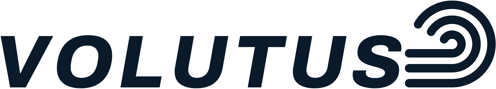
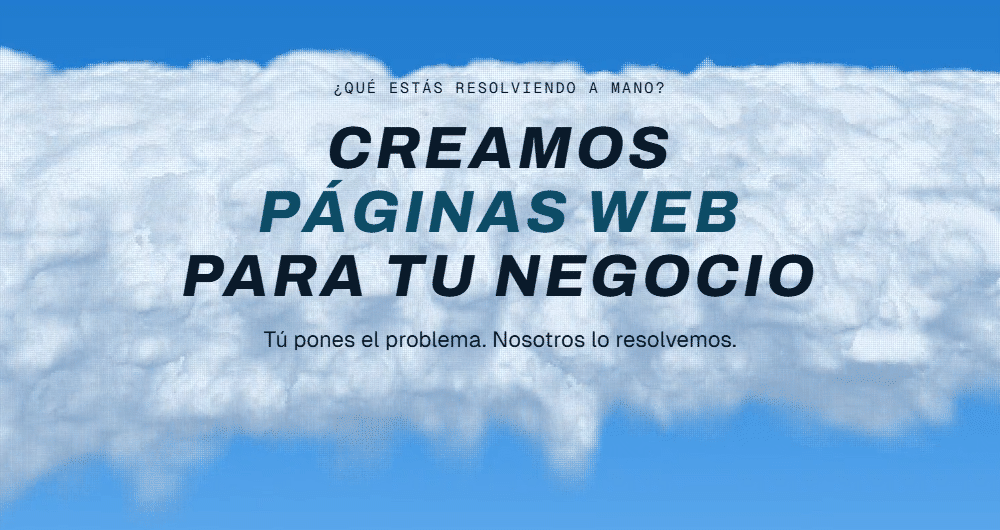
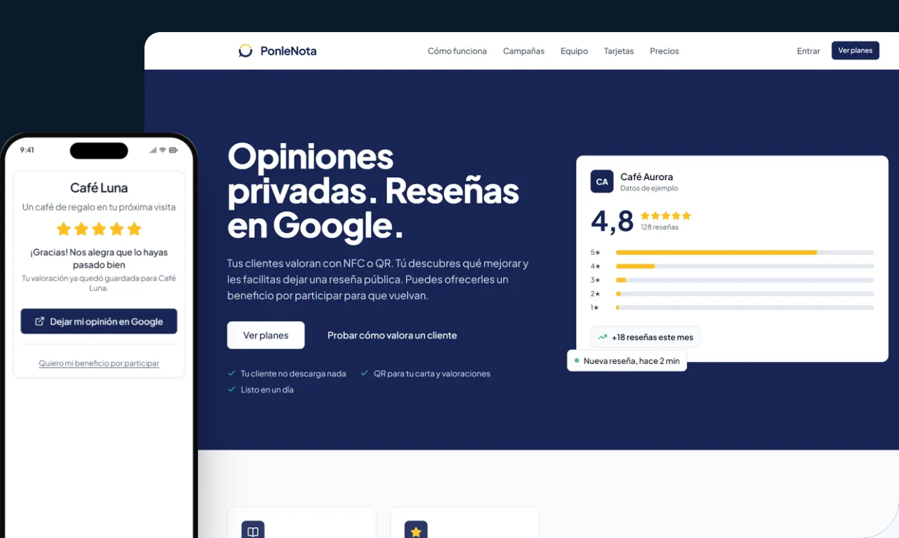
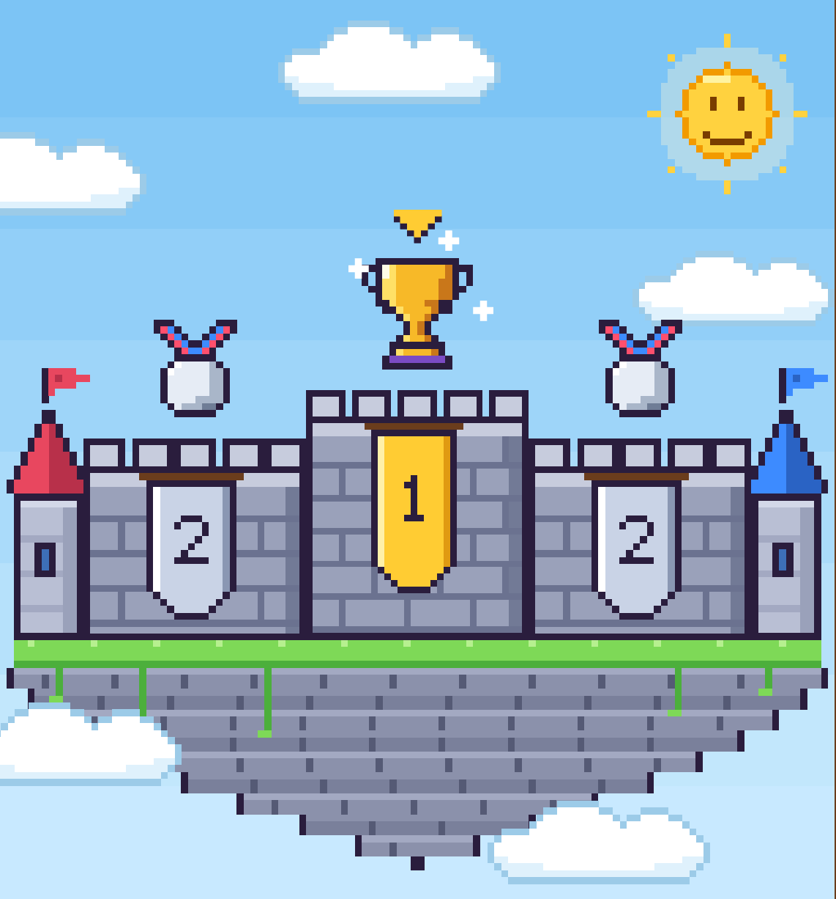

<!--
  La portada de volutus.cl, en el orden de la página: barra, portada,
  servicios, proyectos y logros, contacto y pie.

  Botones, títulos, logotipo y portada son imágenes porque GitHub no deja CSS.
  Salen de scripts/assets.mjs: para cambiar el texto de un botón o un título,
  se edita ahí y se vuelve a correr.

  La regla: cada imagen va dentro de su propio enlace (sin él, GitHub la abre
  sola al tocarla) y cada botón lleva a lo que dice. Nunca una imagen con
  varios botones dibujados.
-->

  <a href="https://volutus.cl"><picture><source media="(prefers-color-scheme: dark)" srcset="assets/logotipo-oscuro.png"></picture></a>

  <a href="https://volutus.cl/nosotros"><b>Nosotros</b></a>&nbsp;&nbsp;·&nbsp;&nbsp;<a href="https://volutus.cl/servicios"><b>Servicios</b></a>&nbsp;&nbsp;·&nbsp;&nbsp;<a href="https://volutus.cl/articulos"><b>Artículos</b></a>&nbsp;&nbsp;·&nbsp;&nbsp;<a href="https://volutus.cl/opiniones"><b>Opiniones</b></a>&nbsp;&nbsp;·&nbsp;&nbsp;<a href="https://volutus.cl/#contacto"><b>Cuéntanos tu proyecto</b></a>

  

  <a href="https://volutus.cl/#contacto"><picture><source media="(prefers-color-scheme: dark)" srcset="assets/botones/cuentanos-oscuro.png"></picture></a>

 

<a href="https://volutus.cl/servicios"><picture><source media="(prefers-color-scheme: dark)" srcset="assets/titulos/servicios-oscuro.png"></picture></a>

<table>
  <tr>
    <td width="50%" valign="top">
      
      <a href="https://volutus.cl/servicios/desarrollo-web"><b>Páginas web</b></a> 
      Una web rápida, clara y pensada para convertir visitas en clientes.
    </td>
    <td width="50%" valign="top">
      
      <a href="https://volutus.cl/servicios/sistemas-de-gestion"><b>Sistemas de gestión</b></a> 
      Un sistema a la medida para ordenar la operación de tu negocio en un solo lugar.
    </td>
  </tr>
  <tr>
    <td width="50%" valign="top">
      
      <a href="https://volutus.cl/servicios/automatizacion-procesos"><b>Automatizaciones</b></a> 
      Conectamos tus herramientas para que las tareas repetitivas ocurran automáticamente.
    </td>
    <td width="50%" valign="top">
      
      <a href="https://volutus.cl/servicios/tiendas-online"><b>Tiendas online</b></a> 
      Vende tus productos por internet con una tienda que puedas administrar.
    </td>
  </tr>
  <tr>
    <td width="50%" valign="top">
      
      <a href="https://volutus.cl/servicios/agentes-ia"><b>Agentes de IA</b></a> 
      Un agente de IA que entiende tu información y se encarga de tareas por ti.
    </td>
    <td width="50%" valign="top">
      
      <a href="https://volutus.cl/servicios/desarrollo-software-a-medida"><b>Aplicaciones</b></a> 
      Una aplicación hecha para resolver una necesidad concreta de tu negocio.
    </td>
  </tr>
  <tr>
    <td width="50%" valign="top">
      
      <a href="https://volutus.cl/servicios/prospeccion-de-clientes"><b>Prospección de clientes</b></a> 
      Encontramos los negocios de tu rubro y zona con sus datos de contacto, listos para ofrecerles lo tuyo.
    </td>
    <td width="50%" valign="top">
      
      <a href="https://volutus.cl/ley21719"><b>Ley de datos</b></a> 
      Adaptamos técnicamente tus sistemas para gestionar los datos personales de acuerdo con la Ley 21.719.
    </td>
  </tr>
</table>

  <a href="https://volutus.cl/servicios"><picture><source media="(prefers-color-scheme: dark)" srcset="assets/botones/servicios-oscuro.png"></picture></a>

 

<a href="https://volutus.cl/#proyectos"><picture><source media="(prefers-color-scheme: dark)" srcset="assets/titulos/proyectos-oscuro.png"></picture></a>

<samp>PROYECTOS</samp> Todo lo que mostramos se puede abrir: el producto en línea o su código.

<table>
  <tr>
    <td width="45%" valign="top">
      
      <h3>PonleNota</h3>
      
ponlenota.cl convierte cada visita a un negocio local en una valoración privada y, si el cliente quiere, en una reseña en Google.

      
<samp>EN LÍNEA</samp> <a href="https://ponlenota.cl">ponlenota.cl ↗</a>

      
<a href="https://ponlenota.cl"><picture><source media="(prefers-color-scheme: dark)" srcset="assets/botones/abrir-sitio-oscuro.png"></picture></a>

    </td>
    <td width="55%" valign="top">
      
    </td>
  </tr>
</table>

<samp>LOGROS CON JURADO EXTERNO</samp>

  

<table>
  <tr>
    <th colspan="3"><samp>TABLA DE HONOR</samp></th>
  </tr>
  <tr>
    <td align="center"><h3>1°</h3></td>
    <td>
      <b>Cisco CyberGames Americas 2026</b> · Primer lugar 
      Rodrigo, socio de Volutus, resolvió las tres misiones de un desafío de ciberseguridad de tres horas, frente a más de 1.000 estudiantes de 21 países.
    </td>
    <td align="center">
      <a href="https://www.linkedin.com/feed/update/urn:li:activity:7479866884285460481/"><picture><source media="(prefers-color-scheme: dark)" srcset="assets/botones/ver-publicacion-oscuro.png"></picture></a>
    </td>
  </tr>
  <tr>
    <td align="center"><h3>2°</h3></td>
    <td>
      <b>Hackathon de Huawei Cloud y Kostra AI</b> · Segundo lugar 
      Un agente de IA que atiende por su cuenta las alertas de infraestructura: reúne el contexto de varios sistemas y propone un diagnóstico con su evidencia, en tiempo real, usando servicios MaaS.
    </td>
    <td align="center">
      <a href="https://github.com/DiegoPyLL/Hackathon-Huawei-Cloud-MaaS"><picture><source media="(prefers-color-scheme: dark)" srcset="assets/botones/ver-codigo-oscuro.png"></picture></a> 
      <a href="https://www.linkedin.com/posts/rodrigo-mart%C3%ADnez-becker-74b6ab241_agenticai-huaweicloud-hackathon-activity-7504179855928913920-ztEm"><picture><source media="(prefers-color-scheme: dark)" srcset="assets/botones/ver-publicacion-oscuro.png"></picture></a>
    </td>
  </tr>
  <tr>
    <td align="center"><h3>2°</h3></td>
    <td>
      <b>9° Seminario Internacional de Ciberseguridad PDI</b> · Segundo lugar 
      El Capture the Flag (CTF) de ciberseguridad de la PDI de Chile permite poner a prueba habilidades técnicas mediante desafíos de identificación de vulnerabilidades, análisis digital y resolución de problemas.
    </td>
    <td></td>
  </tr>
</table>

 

<a href="https://volutus.cl/#contacto"><picture><source media="(prefers-color-scheme: dark)" srcset="assets/titulos/contacto-oscuro.png"></picture></a>

Dinos lo que necesitas en el formulario de volutus.cl. Escríbenos sin compromiso.

  <a href="https://volutus.cl/#contacto"><picture><source media="(prefers-color-scheme: dark)" srcset="assets/botones/escribenos-oscuro.png"></picture></a>

 

  <a href="https://volutus.cl"><picture><source media="(prefers-color-scheme: dark)" srcset="assets/logotipo-oscuro.png"></picture></a>

<samp>CONTÁCTANOS</samp>

  <a href="https://wa.me/56968695173?text=Hola%2C%20vi%20el%20GitHub%20de%20Volutus%20y%20quiero%20conversar%20sobre%20un%20proyecto."><picture><source media="(prefers-color-scheme: dark)" srcset="assets/botones/whatsapp-oscuro.png"></picture></a>

<h3 align="center"><a href="mailto:contacto@volutus.cl">contacto@volutus.cl →</a></h3>

  <a href="https://volutus.cl/nosotros">Quiénes somos</a>&nbsp;&nbsp;·&nbsp;&nbsp;<a href="https://volutus.cl/articulos">Artículos</a>&nbsp;&nbsp;·&nbsp;&nbsp;<a href="https://volutus.cl/opiniones">Opiniones</a>&nbsp;&nbsp;·&nbsp;&nbsp;<a href="https://volutus.cl/privacidad">Privacidad</a>&nbsp;&nbsp;·&nbsp;&nbsp;<a href="#top">Volver arriba ↑</a>

© 2026 Volutus SpA&nbsp;&nbsp;·&nbsp;&nbsp;RUT 78.473.668-7&nbsp;&nbsp;·&nbsp;&nbsp;Santiago, Chile

